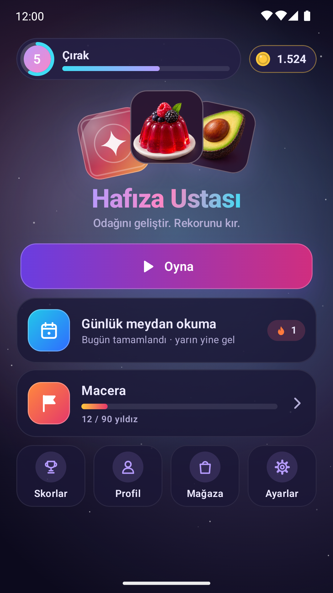
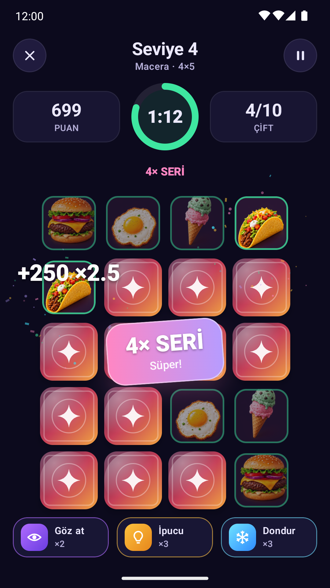
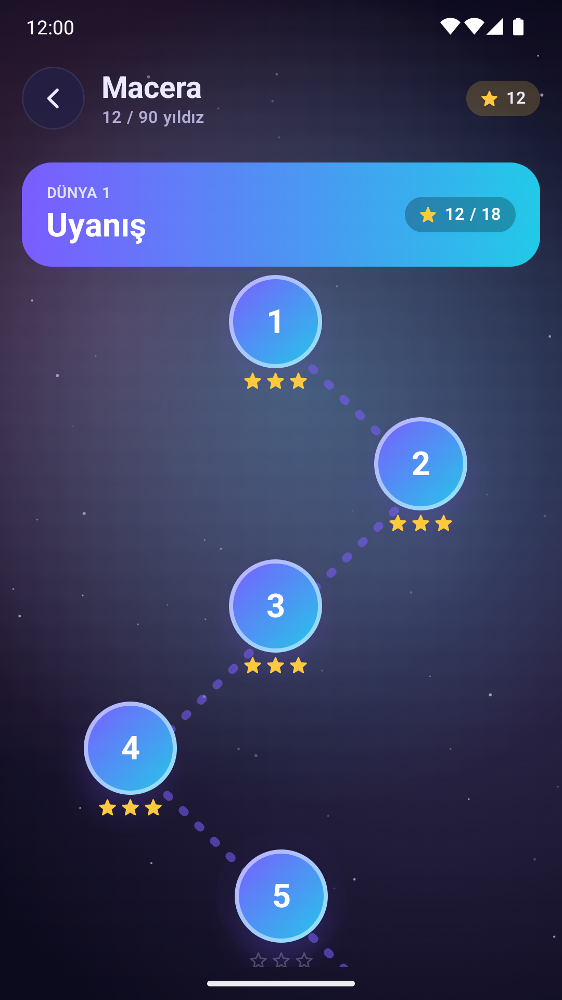
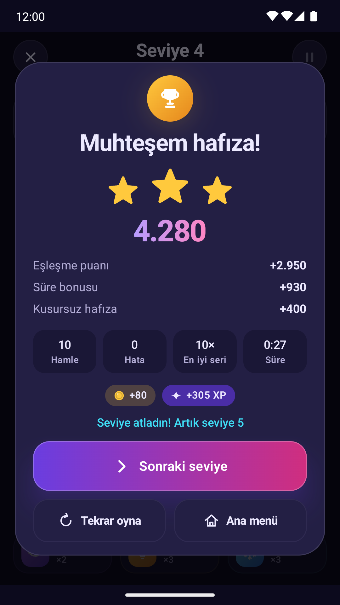

# Hafıza Ustası (Kotlin)

Kart eşleştirme temelli bir hafıza oyunu. 2022'de klasik Android View'larla yazılan ilk sürüm, 3.0 ile **Kotlin + Jetpack Compose** kullanılarak baştan tasarlandı ve ilerleme sistemi olan tam bir mobil oyuna dönüştü. Proje kodu [`HafizaOyunu/`](HafizaOyunu/) klasöründedir.

  
  
  
  

## Neler var?

- **6 oyun modu:** Macera (5 dünya, 30 seviye), Klasik (4×4 / 4×5 / 6×6), Günlük meydan okuma, Hayatta kalma, Zen ve 2 kişilik Düello
- **Sürprizler:** Gözü kapalı, Karıştırma, Buz, Altın çift, Kum saati
- **İlerleme:** seri çarpanı, yıldızlar, XP ve seviyeler, 23 başarım, istatistikler, günlük seri
- **Mağaza:** oyunda kazanılan altınla güçlendiriciler ve kart arkaları (gerçek para yok)
- **5 kart paketi**, 3D kart animasyonları, parçacık efektleri ve kodla sentezlenen ses efektleri
- Türkçe ve İngilizce, koyu/açık tema; tamamen çevrimdışı ve reklamsız

Kurulum, mimari ve derleme ayrıntıları için [HafizaOyunu/README.md](HafizaOyunu/README.md); sürüm değişiklikleri için [HafizaOyunu/SURUM-3.0-NOTLARI.md](HafizaOyunu/SURUM-3.0-NOTLARI.md).

## İlk sürüm (2022)

Depodaki `Hafiza_Oyunu_Video.gif` ve `gezgor.mp4` dosyaları, uygulamanın 2022'deki ilk sürümünün tanıtım kayıtlarıdır. O sürümün kodu bu deponun git geçmişinde durmaktadır.
